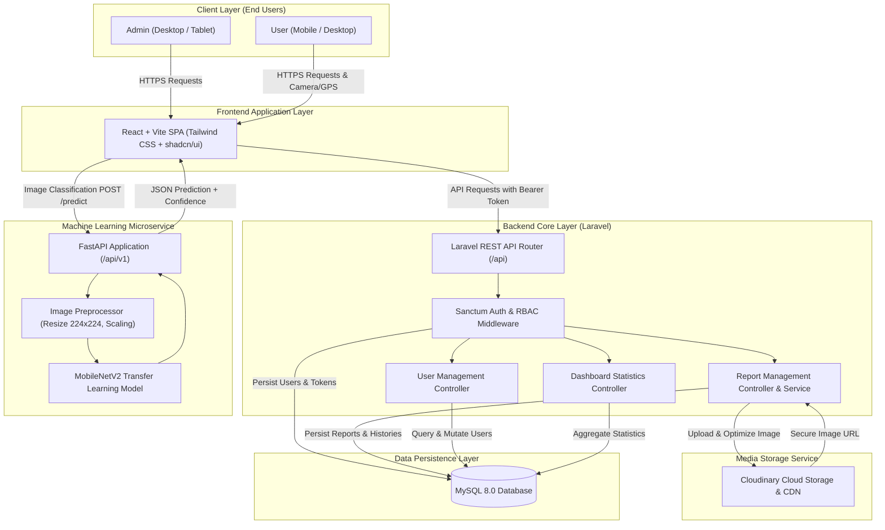
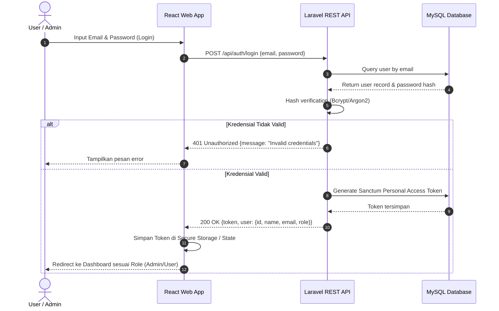
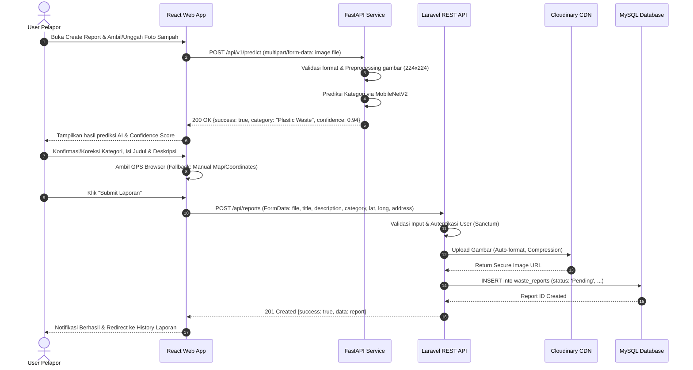
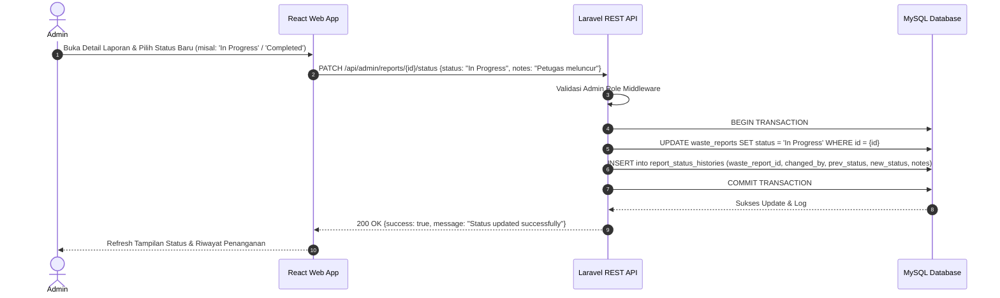
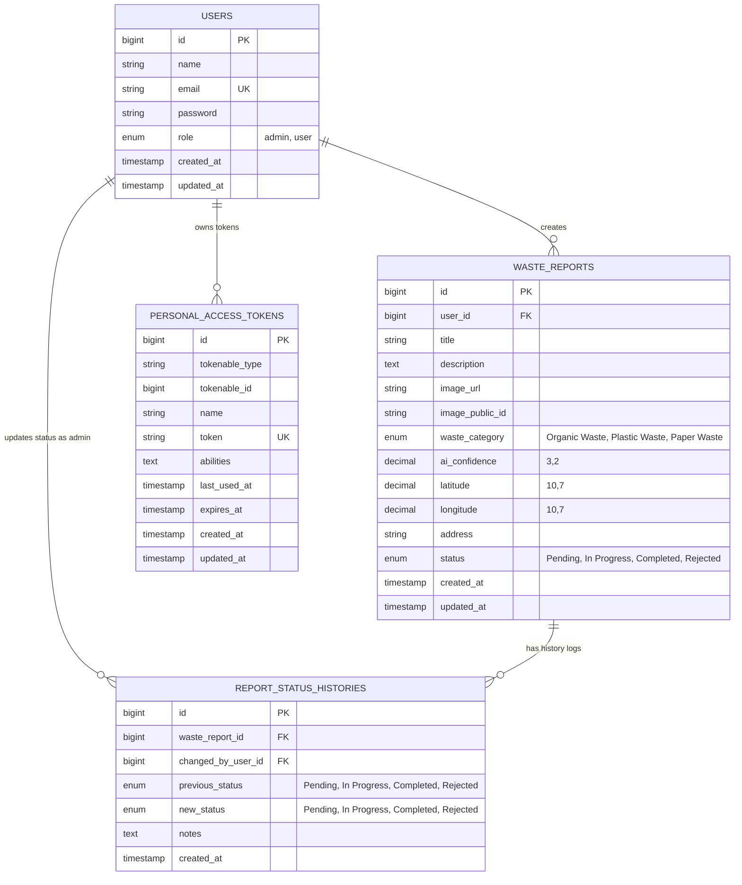
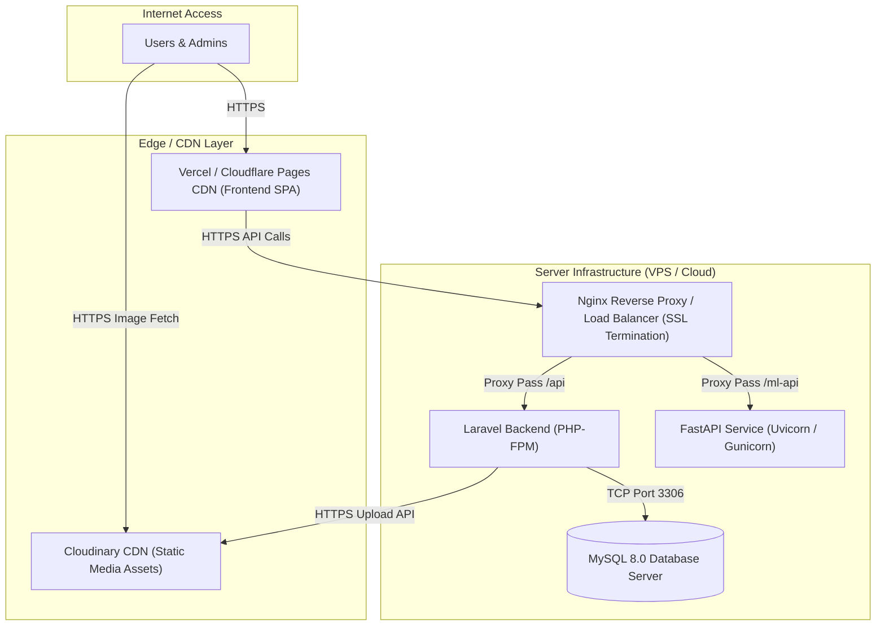

# SYSTEM ARCHITECTURE

## Smart Waste Management System

**Version:** 1.2.0  
**Status:** Draft  
**Project Type:** Web Application & Machine Learning  
**Date:** 3 November 2026  
**Document Reference:** [PRD.md](file:///Users/ahmadqomaruddin/Documents/smart-waste-management/docs/PRD.md) v1.2.0

---

## 1. Architecture Overview

Smart Waste Management System mengadopsi arsitektur terdistribusi (*Decoupled Client-Server & Microservice*) yang memisahkan antarmuka pengguna (*Frontend*), pemrosesan logika bisnis & autentikasi (*Backend API*), penyimpanan data relasional (*Database*), layanan inferensi kecerdasan buatan (*Machine Learning API*), serta penyimpanan media awan (*Cloud Image Storage*).

Arsitektur ini dirancang untuk memastikan skalabilitas, keandalan, pemisahan tanggung jawab (*Separation of Concerns*), serta kemudahan perawatan sistem.

Sistem terdiri dari lima komponen inti:

1. **Frontend Web Application:** Dibangun menggunakan React + Vite (TypeScript) sebagai Single Page Application (SPA), dengan styling Tailwind CSS dan komponen antarmuka shadcn/ui.
2. **Backend REST API:** Dibangun menggunakan framework Laravel yang mengimplementasikan autentikasi berbasis token dengan Laravel Sanctum, otorisasi RBAC (*Role-Based Access Control*), dan manajemen data pelaporan.
3. **Database:** Menggunakan Relational Database Management System (RDBMS) MySQL untuk menyimpan data pengguna, laporan sampah, dan riwayat status penanganan.
4. **Machine Learning Service:** Layanan API independen berbasis FastAPI (Python) yang memuat model deep learning TensorFlow/Keras berbasis MobileNetV2 untuk klasifikasi kategori sampah secara real-time.
5. **Cloud Image Storage:** Menggunakan Cloudinary untuk mengelola unggahan, optimasi, dan pengiriman foto bukti laporan sampah.

---

## 2. Technology Stack

| Layer / Component | Technology | Version / Spec | Responsibility |
|---|---|---|---|
| **Frontend** | React + Vite + TypeScript | React 18+ / Vite 5+ | Antarmuka interaktif Admin dan User (SPA), State Management, Integrasi API |
| **Routing** | React Router | React Router DOM v6+ | Client-side routing, protected routes (Role-Based Access) |
| **UI Framework** | Tailwind CSS + shadcn/ui | Tailwind v4+, Radix UI | Komponen antarmuka yang konsisten, modern, dan sepenuhnya responsif |
| **Backend API** | Laravel (PHP) | Laravel 11.x (PHP 8.2+) | RESTful API, Business Logic, Validasi, RBAC, Integrasi DB & Storage |
| **Authentication** | Laravel Sanctum | Native Sanctum Token | Autentikasi berbasis Bearer Token untuk API SPA/Web |
| **Database** | MySQL | MySQL 8.0+ | Penyimpanan relasional persisten data pengguna, laporan, dan log status |
| **ML Framework** | Python & TensorFlow/Keras | Python 3.10+, TensorFlow 2.x | Pelatihan dan inferensi model Transfer Learning MobileNetV2 |
| **ML Serving API** | FastAPI + Uvicorn | FastAPI 0.110+ | Endpoint inferensi klasifikasi gambar berkecepatan tinggi |
| **Image Storage** | Cloudinary | Cloudinary REST API / SDK | Penyimpanan aset media terkelola dengan CDN dan kompresi otomatis |
| **Version Control** | Git + GitHub | Git 2.x | Manajemen source code, kolaborasi, dan versioning |

---

## 3. System Architecture Diagram

### 3.1 High-Level Architecture



---

## 4. Sequence Diagrams

### 4.1 Authentication & Session Management Flow



### 4.2 Waste Report Creation Flow with AI Classification



### 4.3 Report Status Update Flow (Admin)



---

## 5. Application Responsibilities

### 5.1 Frontend — React + Vite + TypeScript

Frontend bertanggung jawab menyediakan antarmuka pengguna Single Page Application (SPA) yang interaktif, responsif (*mobile, tablet, desktop*), serta berkinerja tinggi menggunakan React dengan build tool Vite.

**Fitur & Tanggung Jawab:**
- **Build Tooling & Fast Development:** Ditenagai oleh Vite dengan Hot Module Replacement (HMR) berkecepatan tinggi, integrasi TypeScript bawaan, serta optimized bundle via Rollup untuk produksi.
- **Client-Side Routing & Protected Routes:** Menggunakan React Router DOM (v6+) untuk manajemen navigasi SPA dan perlindungan rute (*route guards*) berdasarkan autentikasi token Sanctum dan verifikasi role (`Role-Based Access Control`).
- **State Management & Data Fetching:** Menggunakan TanStack Query (React Query) dan Axios Client (`import.meta.env.VITE_API_BASE_URL`) dengan request interceptor untuk melampirkan Bearer Token secara otomatis serta response interceptor untuk menangani 401 Unauthorized (auto-logout / redirect).
- **Form Handling & Validation:** Menggunakan React Hook Form dan Zod schema validator untuk validasi form client-side sebelum dikirim ke API.
- **AI Classification Consumer:** Mengirim file gambar langsung ke FastAPI `/predict` saat gambar dipilih oleh user, lalu menampilkan hasil kategori terprediksi dan confidence score secara visual secara instan.
- **Geolocation & Device API:** Mengakses Geolocation API browser untuk memperoleh koordinat Latitude & Longitude pelapor, dilengkapi fallback form koordinat manual atau titik peta jika izin GPS ditolak.
- **Admin Interfaces:**
  - Admin Dashboard (Statistik jumlah laporan per status, grafik tren waktu, pie chart kategori sampah, tabel aktivitas laporan terbaru).
  - Manajemen Seluruh Laporan (Tabel dengan fitur search judul/pelapor, filter status, filter kategori, filter tanggal, pagination, modal update status & hapus laporan).
  - Manajemen Pengguna (CRUD user, pencarian user, jumlah laporan tiap user).
- **User Interfaces:**
  - User Dashboard (Ringkasan status laporan pribadi: Pending, In Progress, Completed, Rejected).
  - Form Pembuatan Laporan interaktif.
  - Riwayat Laporan Pengguna (Pencarian, filter status/kategori, pagination, serta aksi edit/hapus hanya jika laporan berstatus `Pending`).
  - Manajemen Profil (Ubah nama, informasi profil, ganti password).

### 5.2 Backend — Laravel REST API

Laravel berperan sebagai pusat kendali logika bisnis (*Business Logic*), otentikasi, validasi data server-side, dan integrasi penyimpanan.

**Fitur & Tanggung Jawab:**
- **Authentication & RBAC:**
  - Manajemen token via Laravel Sanctum.
  - Hash password menggunakan standar industri (Bcrypt / Argon2id).
  - Middleware otorisasi (`role:admin`, `role:user`) untuk melindungi rute privat.
- **Waste Report Lifecycle Management:**
  - Validasi ketat request payload (tipe file, ukuran file, batas karakter, validitas koordinat).
  - Mengunggah foto laporan ke Cloudinary dan menyimpan URL hasil upload.
  - Membatasi modifikasi laporan: User hanya dapat mengubah/menghapus laporannya sendiri yang masih berstatus `Pending`. Admin memiliki hak akses penuh.
  - Menangani transaksi database (*Database Transactions*) untuk memastikan integritas saat status laporan diperbarui beserta pencatatan riwayatnya di tabel `report_status_histories`.
- **Dashboard Aggregations:**
  - Endpoint agregasi data statistik untuk Admin (global) dan User (scoped to authenticated user).
- **Security & Error Handling:**
  - Perlindungan terhadap ancaman umum (SQL Injection melalui Eloquent ORM, XSS, CSRF, Rate Limiting / API Throttling).
  - Format respon JSON terstandarisasi untuk keseragaman integrasi frontend.

### 5.3 Database — MySQL 8.0

MySQL bertindak sebagai sistem database relasional utama untuk menyimpan data terstruktur.

**Data yang Dikelola:**
- Kredensial dan profil pengguna beserta role aksesnya.
- Data laporan sampah (judul, deskripsi, tautan foto Cloudinary, koordinat latitude/longitude, alamat teks, kategori hasil AI, tingkat confidence AI, status penanganan saat ini).
- Riwayat audit log perubahan status laporan (*status history logging*).
- Token sesi API Sanctum (`personal_access_tokens`).

### 5.4 Machine Learning Service — FastAPI

Layanan independen berbasis Python yang bertindak sebagai mesin inferensi visi komputer (*Computer Vision Inference Engine*).

**Fitur & Tanggung Jawab:**
- **Model Loader:** Memuat model transfer learning TensorFlow/Keras berbasis MobileNetV2 ke memori saat startup (*lifecycle event*) untuk menghindari latency reload tiap request.
- **Image Preprocessing:**
  - Memvalidasi format file (hanya JPEG, JPG, PNG) dan ukuran file.
  - Melakukan konversi gambar ke RGB.
  - Resize citra menjadi resolusi input model target ($224 \times 224$ piksel).
  - Normalisasi nilai piksel sesuai dengan pipeline MobileNetV2 (`tf.keras.applications.mobilenet_v2.preprocess_input`).
- **Inference & Prediction:**
  - Melakukan feed-forward pada model untuk menghasilkan distribusi probabilitas Softmax.
  - Memetakan index kelas tertinggi (*argmax*) ke 3 kategori sampah target:
    1. **Organic Waste**
    2. **Plastic Waste**
    3. **Paper Waste**
  - Mengembalikan nama kategori beserta nilai keyakinan (*confidence score* 0.00 – 1.00) dalam format JSON.
- **Swagger Documentation:** Menyediakan dokumentasi OpenAPI/Swagger UI otomatis di `/docs`.

### 5.5 Cloud Image Storage — Cloudinary

Cloudinary menyediakan infrastruktur penyimpanan file multimedia tanpa membebani penyimpanan lokal server aplikasi.

**Fitur & Tanggung Jawab:**
- Menyimpan file foto laporan sampah secara aman di cloud storage.
- Melakukan transformasi otomatis: konversi format cerdas (`f_auto`) dan kompresi kualitas optimal (`q_auto`) untuk mempercepat rendering gambar di web.
- Menyediakan URL publik berbasis CDN (*Content Delivery Network*) dengan HTTPS.

---

## 6. Database Design & Schema

### 6.1 Entity-Relationship Diagram (ERD)



### 6.2 Table Specifications & Schema Definitions

#### 1. Table: `users`
Menyimpan data pengguna dan hak akses peran (*role*).

| Column | Data Type | Nullable | Default | Description |
|---|---|---|---|---|
| `id` | BIGINT UNSIGNED | No | AUTO_INCREMENT | Primary Key |
| `name` | VARCHAR(255) | No | - | Nama lengkap pengguna |
| `email` | VARCHAR(255) | No | - | Alamat email unik untuk autentikasi |
| `password` | VARCHAR(255) | No | - | Password ter-hash (Bcrypt) |
| `role` | ENUM('admin', 'user') | No | 'user' | Peran pengguna dalam sistem |
| `remember_token` | VARCHAR(100) | Yes | NULL | Token sesi "remember me" |
| `created_at` | TIMESTAMP | Yes | NULL | Waktu pembuatan akun |
| `updated_at` | TIMESTAMP | Yes | NULL | Waktu pembaruan profil |

- **Indexes:** `PRIMARY KEY (id)`, `UNIQUE KEY (email)`.

#### 2. Table: `waste_reports`
Menyimpan seluruh data transaksi pelaporan sampah oleh pengguna.

| Column | Data Type | Nullable | Default | Description |
|---|---|---|---|---|
| `id` | BIGINT UNSIGNED | No | AUTO_INCREMENT | Primary Key |
| `user_id` | BIGINT UNSIGNED | No | - | Foreign Key ke `users.id` (pemilik laporan) |
| `title` | VARCHAR(255) | No | - | Judul ringkas laporan sampah |
| `description` | TEXT | No | - | Uraian detail kondisi sampah |
| `image_url` | VARCHAR(500) | No | - | URL aset foto di Cloudinary |
| `image_public_id` | VARCHAR(255) | Yes | NULL | Public ID aset Cloudinary untuk referensi asset |
| `waste_category` | ENUM('Organic Waste', 'Plastic Waste', 'Paper Waste') | No | - | Kategori sampah terkonfirmasi |
| `ai_confidence` | DECIMAL(5, 4) | Yes | NULL | Tingkat keyakinan prediksi model AI (0.0000 - 1.0000) |
| `latitude` | DECIMAL(10, 7) | No | - | Koordinat lintang lokasi sampah |
| `longitude` | DECIMAL(10, 7) | No | - | Koordinat bujur lokasi sampah |
| `address` | VARCHAR(500) | Yes | NULL | Alamat deskriptif / patokan lokasi |
| `status` | ENUM('Pending', 'In Progress', 'Completed', 'Rejected') | No | 'Pending' | Status pemrosesan laporan saat ini |
| `created_at` | TIMESTAMP | Yes | NULL | Waktu laporan dibuat |
| `updated_at` | TIMESTAMP | Yes | NULL | Waktu terakhir laporan diperbarui |

- **Indexes:** 
  - `PRIMARY KEY (id)`
  - `FOREIGN KEY (user_id) REFERENCES users(id) ON DELETE CASCADE`
  - `INDEX idx_reports_status (status)`
  - `INDEX idx_reports_category (waste_category)`
  - `INDEX idx_reports_created_at (created_at)`

#### 3. Table: `report_status_histories`
Mencatat jejak audit pergeseran status penanganan laporan sampah oleh administrator.

| Column | Data Type | Nullable | Default | Description |
|---|---|---|---|---|
| `id` | BIGINT UNSIGNED | No | AUTO_INCREMENT | Primary Key |
| `waste_report_id` | BIGINT UNSIGNED | No | - | Foreign Key ke `waste_reports.id` |
| `changed_by_user_id` | BIGINT UNSIGNED | No | - | Foreign Key ke `users.id` (Admin yang melakukan perubahan) |
| `previous_status` | ENUM('Pending', 'In Progress', 'Completed', 'Rejected') | Yes | NULL | Status sebelum perubahan |
| `new_status` | ENUM('Pending', 'In Progress', 'Completed', 'Rejected') | No | - | Status setelah perubahan |
| `notes` | TEXT | Yes | NULL | Catatan/keterangan penanganan dari admin |
| `created_at` | TIMESTAMP | Yes | CURRENT_TIMESTAMP | Waktu terjadinya perubahan status |

- **Indexes:**
  - `PRIMARY KEY (id)`
  - `FOREIGN KEY (waste_report_id) REFERENCES waste_reports(id) ON DELETE CASCADE`
  - `FOREIGN KEY (changed_by_user_id) REFERENCES users(id) ON DELETE RESTRICT`
  - `INDEX idx_history_report (waste_report_id)`

#### 4. Table: `personal_access_tokens`
Tabel standar Laravel Sanctum untuk manajemen Bearer Token.

---

## 7. Machine Learning Architecture & Pipeline

### 7.1 Model Specification

- **Base Architecture:** MobileNetV2 (Pre-trained weights on ImageNet).
- **Approach:** Transfer Learning & Fine-Tuning.
  - Base MobileNetV2 model dengan layer atas (*classification head*) dipotong.
  - Ditambahkan layer kustom: `GlobalAveragePooling2D`, `Dense(128, activation='relu')`, `Dropout(0.3)`, dan `Dense(3, activation='softmax')`.
- **Target Classes (3 Kategori):**
  1. `Organic Waste`
  2. `Plastic Waste`
  3. `Paper Waste`
- **Minimum Evaluation Metric:** Testing Accuracy $\ge 80\%$ pada dataset pengujian yang tidak pernah dilihat model saat pelatihan.

### 7.2 Preprocessing & Inference Pipeline

```mermaid
flowchart LR
    Upload["Input File (JPEG/PNG)"] --> Validation["File Type & Size Check"]
    Validation --> Decode["Image Decoding & RGB Conversion"]
    Decode --> Resize["Resize to 224x224"]
    Resize --> Scale["MobileNetV2 preprocess_input"]
    Scale --> Inference["TensorFlow Model Predict"]
    Inference --> Softmax["Softmax Probability Output"]
    Softmax --> ClassMap["Argmax to Waste Category Label"]
    ClassMap --> Response["FastAPI JSON Response"]
```



### 7.3 FastAPI Endpoints

Base URL: `/api/v1`

| Method | Endpoint | Request Body | Response Success (200) | Description |
|---|---|---|---|---|
| `GET` | `/health` | None | `{"status": "healthy", "model_loaded": true}` | Pemeriksaan ketersediaan service & status model |
| `POST` | `/predict` | `multipart/form-data` (`file: UploadFile`) | Format JSON Prediksi (lihat contoh di bawah) | Melakukan inferensi gambar sampah |

#### Contoh Format Response Prediksi:
```json
{
  "success": true,
  "prediction": {
    "category": "Plastic Waste",
    "confidence": 0.9425
  },
  "execution_time_ms": 84.5
}
```

#### Penanganan Error Inferensi:
- **400 Bad Request:** Format file bukan citra gambar valid (misal: PDF atau text file).
- **413 Payload Too Large:** Ukuran berkas melebihi batas (maksimum 5MB).
- **500 Internal Server Error:** Kegagalan kalkulasi model (disertai logging server tanpa menghentikan worker service).

---

## 8. Backend API Specifications & RBAC Matrix

### 8.1 Base API URL
```text
https://api.smartwaste.domain/api
```

### 8.2 Role-Based Access Control (RBAC) Matrix

| Endpoint | HTTP Method | Public / Auth | Allowed Roles | Description |
|---|---|---|---|---|
| `/auth/register` | `POST` | Public | All (Tamu) | Registrasi akun pengguna baru |
| `/auth/login` | `POST` | Public | All (Tamu) | Login pengguna/admin & perolehan Sanctum Token |
| `/auth/logout` | `POST` | Authenticated | Admin, User | Pencabutan token sesi aktif |
| `/auth/me` | `GET` | Authenticated | Admin, User | Mengambil informasi profil login |
| `/profile` | `PUT` | Authenticated | Admin, User | Memperbarui nama dan profil pengguna |
| `/profile/password` | `PUT` | Authenticated | Admin, User | Memperbarui password |
| `/dashboard/stats` | `GET` | Authenticated | Admin, User | Statistik ringkasan (User: milik sendiri; Admin: agregasi sistem) |
| `/reports` | `GET` | Authenticated | Admin, User | List laporan (User: milik sendiri; Admin: seluruh sistem) |
| `/reports` | `POST` | Authenticated | User | Membuat laporan baru |
| `/reports/{id}` | `GET` | Authenticated | Admin, User | Melihat detail laporan (User dibatasi hanya laporannya) |
| `/reports/{id}` | `PUT` | Authenticated | Admin, User | Mengubah data laporan (User hanya jika status `Pending`) |
| `/reports/{id}` | `DELETE` | Authenticated | Admin, User | Menghapus laporan (User hanya jika status `Pending`) |
| `/admin/reports/{id}/status` | `PATCH` | Authenticated | Admin Only | Memperbarui status laporan dan mencatat history log |
| `/admin/users` | `GET` | Authenticated | Admin Only | Menampilkan daftar seluruh pengguna beserta statistik laporan |
| `/admin/users` | `POST` | Authenticated | Admin Only | Menambahkan pengguna baru oleh admin |
| `/admin/users/{id}` | `GET` | Authenticated | Admin Only | Melihat detail data pengguna tertentu |
| `/admin/users/{id}` | `PUT` | Authenticated | Admin Only | Memperbarui data pengguna oleh admin |
| `/admin/users/{id}` | `DELETE` | Authenticated | Admin Only | Menghapus pengguna |

### 8.3 Standardized API Response Structure

#### Success Response
```json
{
  "success": true,
  "message": "Waste report created successfully.",
  "data": {
    "id": 102,
    "title": "Tumpukan Sampah Plastik di Trotoar",
    "waste_category": "Plastic Waste",
    "status": "Pending",
    "image_url": "https://res.cloudinary.com/.../waste-102.jpg",
    "latitude": -6.2088,
    "longitude": 106.8456,
    "created_at": "2026-11-03T10:30:00Z"
  }
}
```

#### Error Response
```json
{
  "success": false,
  "message": "The given data was invalid.",
  "errors": {
    "image": ["The image file size must not exceed 5MB."],
    "latitude": ["The latitude field is required."]
  }
}
```

---

## 9. Security Architecture

1. **Authentication & Authorization:**
   - Stateless Bearer Token menggunakan Laravel Sanctum.
   - Password di-hash menggunakan algoritma Bcrypt dengan cost factor yang memadai.
   - Middleware otorisasi memverifikasi setiap request ke rute `/admin/*` untuk memastikan hanya pengguna dengan `role = 'admin'` yang dapat mengakses.
2. **Data Isolation & Access Boundary:**
   - Pengguna non-admin dibatasi oleh scope query Eloquent (`where('user_id', auth()->id())`) saat mengambil, melihat detail, atau mengubah laporan, sehingga mencegah IDOR (*Insecure Direct Object Reference*).
3. **Upload Sanitization & Storage Security:**
   - Validasi ketat pada backend: hanya ekstensi `jpg`, `jpeg`, `png` dengan MIME type terverifikasi dan ukuran maksimal 5MB.
   - File tidak dieksekusi di server lokal, melainkan diunggah langsung ke Cloudinary melalui secure API credentials.
4. **Cross-Origin Resource Sharing (CORS):**
   - Backend membatasi `Allowed Origins` hanya ke domain frontend resmi untuk mencegah unauthorized cross-site requests.
5. **Rate Limiting (Throttling):**
   - Pembatasan request rate pada endpoint publik (misal: `60 requests/minute` untuk endpoint umum, `5 requests/minute` untuk endpoint login) guna memitigasi serangan Brute Force dan Denial-of-Service.
6. **Environment Variables Security:**
   - Kunci API rahasia (Database credentials, Sanctum secret, Cloudinary API Key & Secret) dikelola secara ketat melalui berkas `.env` dan dilarang untuk di-commit ke repositori Git.

---

## 10. Error Handling & System Resilience

Sistem dirancang untuk tetap dapat beroperasi secara andal (*resilient*) saat menghadapi potensi kegagalan parsial:

1. **Kegagalan Prediksi AI (FastAPI Down / Timeout):**
   - Jika layanan FastAPI mengalami kendala teknis atau tidak dapat dihubungi saat user memilih foto, frontend menampilkan notifikasi informatif: *"Layanan prediksi AI sedang tidak tersedia. Silakan pilih kategori sampah secara manual."*
   - Proses pembuatan laporan sampah **tidak boleh terblokir**, user tetap dapat memilih kategori dari dropdown dan mengirim laporan ke Laravel backend.
2. **Kegagalan Penyimpanan Cloudinary:**
   - Jika koneksi ke Cloudinary gagal, backend menggagalkan transaksi (*rollback*), mengembalikan HTTP 500 dengan pesan yang jelas, dan tidak menyimpan data inkonsisten ke MySQL.
3. **Database Transactions:**
   - Operasi perubahan status laporan menggunakan `DB::transaction()` untuk menjamin bahwa pembaruan kolom `status` di tabel `waste_reports` dan pencatatan riwayat di `report_status_histories` bersifat atomik (*All-or-Nothing*).

---

## 11. Deployment Architecture



### Rencana Target Hosting

| Component | Recommended Hosting / Platform | Rationale |
|---|---|---|
| **Frontend (React + Vite SPA)** | Vercel / Cloudflare Pages / Netlify | Static SPA hosting dengan global CDN, automated CI/CD build preview, dan latensi rendah |
| **Backend API (Laravel)** | Linux VPS (Ubuntu 22.04 / 24.04 LTS) | Fleksibilitas konfigurasi PHP-FPM, Nginx, worker queue, dan cron schedule |
| **Database (MySQL)** | VPS / Managed Cloud MySQL | Dukungan ACID, indexing relasional optimal, pencadangan (*backup*) berkala |
| **ML Service (FastAPI)** | Linux VPS (Docker Container / Uvicorn) | Isolasi environment Python, kemudahan alokasi CPU untuk inferensi TensorFlow |
| **Image Storage** | Cloudinary | Menghemat disk storage server, menyediakan CDN global serta kompresi otomatis |

---

## 12. Project Directory Structure

Struktur direktori dirancang modular dan terorganisasi untuk mendukung pengembangan terpisah antara Frontend, Backend, Machine Learning, dan Dokumentasi:

```text
smart-waste-management/
│
├── apps/
│   └── web/                                # Frontend React + Vite SPA Application
│       ├── public/                         # Static assets (favicons, icons, placeholders)
│       ├── src/
│       │   ├── assets/                     # Frontend image & SVG assets
│       │   ├── components/                 # Reusable UI components
│       │   │   ├── ui/                     # shadcn/ui primitives (Button, Modal, Card, etc.)
│       │   │   ├── reports/                # Report cards, forms, filter bars
│       │   │   └── layout/                 # Navbar, Sidebar, Footer
│       │   ├── contexts/                   # React Contexts (AuthContext, ThemeContext)
│       │   ├── hooks/                      # Custom React hooks (useGeolocation, useAuth)
│       │   ├── layouts/                    # Layout wrappers (AuthLayout, AdminLayout, UserLayout)
│       │   ├── lib/                        # Utility functions, axios client instance (`axios.create`)
│       │   ├── pages/                      # Page components (Landing, Login, Register, Dashboards)
│       │   │   ├── admin/                  # Admin pages (Dashboard, ReportManagement, UserManagement)
│       │   │   ├── user/                   # User pages (Dashboard, CreateReport, ReportHistory, Profile)
│       │   │   └── auth/                   # Auth pages (Login, Register)
│       │   ├── routes/                     # React Router config & ProtectedRoute guards
│       │   ├── services/                   # API service calls (authService, reportService, aiService)
│       │   ├── types/                      # TypeScript definitions & interfaces
│       │   ├── App.tsx                     # Main App component & Route provider
│       │   └── main.tsx                    # Vite entry point (ReactDOM.createRoot)
│       ├── index.html                      # Single Page Application HTML entry
│       ├── vite.config.ts                  # Vite configuration & path aliases (@/*)
│       ├── tailwind.config.ts              # Tailwind CSS configuration
│       ├── tsconfig.json                   # TypeScript configuration
│       ├── .env.example                    # Environment variable template (VITE_API_BASE_URL)
│       └── package.json
│
├── backend/                                # Backend Laravel REST API Application
│   ├── app/
│   │   ├── Http/
│   │   │   ├── Controllers/                # Auth, Report, User, Dashboard Controllers
│   │   │   ├── Middleware/                 # Sanctum Auth, RoleVerification Middleware
│   │   │   ├── Requests/                   # Form Request Validation classes
│   │   │   └── Resources/                  # Eloquent API Resources (JSON transformers)
│   │   ├── Models/                         # User, WasteReport, ReportStatusHistory
│   │   └── Services/                       # CloudinaryService, ReportService
│   ├── config/                             # App, database, sanctum, and cloudinary config
│   ├── database/
│   │   ├── migrations/                     # MySQL Table Schema Migrations
│   │   └── seeders/                        # Admin & sample user data seeders
│   ├── routes/
│   │   └── api.php                         # Application REST API routes
│   └── composer.json
│
├── machine-learning/                       # Machine Learning & AI Classification Service
│   ├── dataset/                            # Dataset sampah (Organic, Plastic, Paper)
│   │   ├── train/
│   │   ├── val/
│   │   └── test/
│   ├── notebooks/                          # Jupyter Notebooks (EDA, Training, Evaluation)
│   ├── models/                             # Serialized trained model (.keras / .h5)
│   ├── app/                                # FastAPI Serving Application
│   │   ├── main.py                         # FastAPI entry point & routes (/health, /predict)
│   │   ├── preprocessor.py                 # Image transformation & scaling utilities
│   │   └── config.py                       # ML Service settings
│   └── requirements.txt                    # Python dependencies (fastapi, tensorflow, etc.)
│
├── docs/                                   # Project Documentation
│   ├── PRD.md                              # Product Requirements Document v1.2.0
│   └── system-architecture.md              # System Architecture Document v1.2.0
│
├── .gitignore
└── README.md
```

---

**End of Document**
